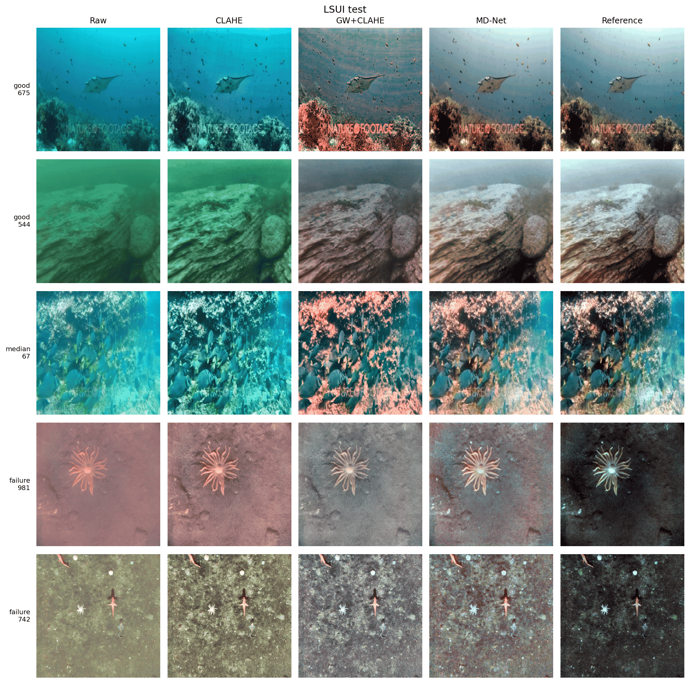
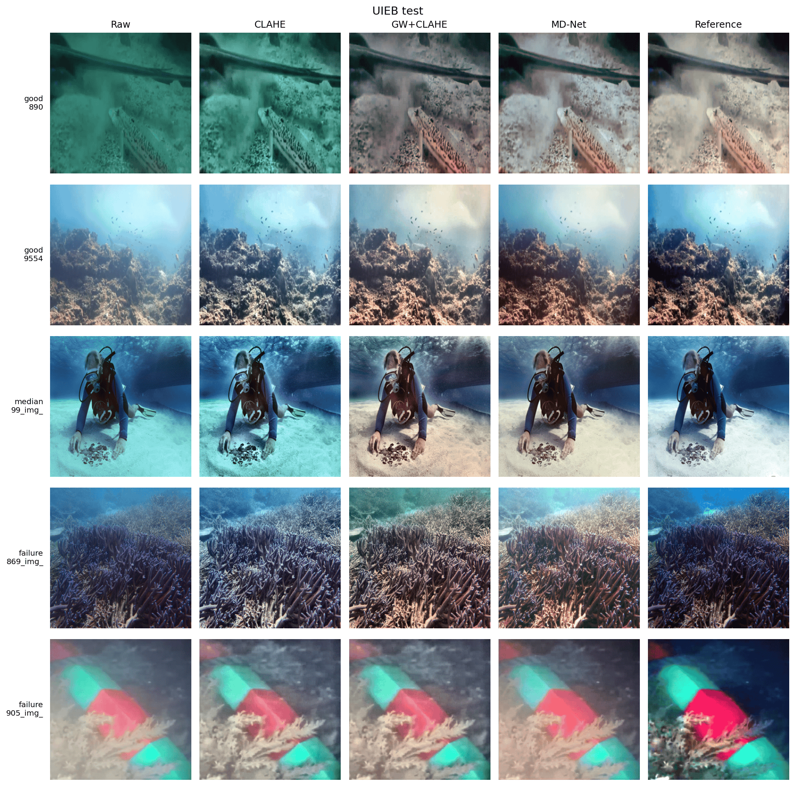
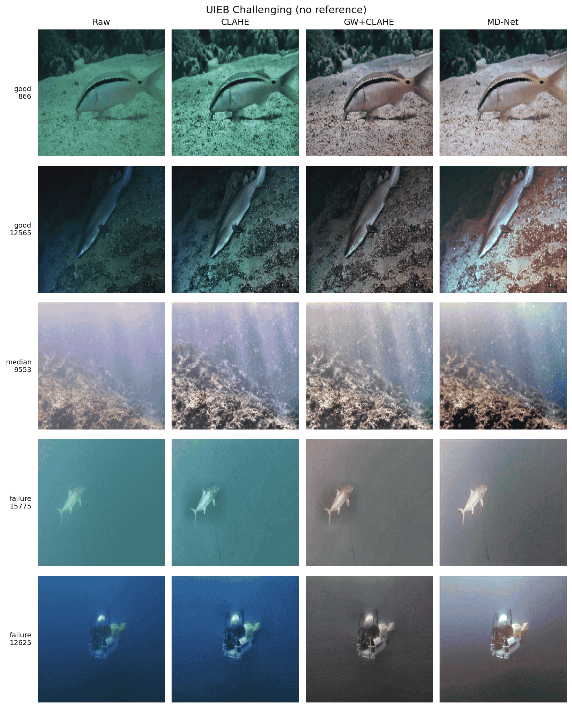

# MD-Net — Underwater Image Enhancement (PyTorch re-implementation)

An independent re-implementation, training and evaluation of **MD-Net**, a multiscale disentanglement network for underwater image enhancement from:

> J. Yan, H. Hu, Y. Wang, M. W. Nawaz, N. U. R. Junejo, E. Guo, H. Feng. *Underwater image enhancement via multiscale disentanglement strategy.* Scientific Reports 15, 6076 (2025). https://doi.org/10.1038/s41598-025-89109-7

I trained the network on LSUI + UIEB with the paper's settings, evaluated it on LSUI, UIEB and the UIEB Challenging set, compared it with classical baselines, and documented where my results differ from the paper and why. **This is a re-implementation for learning and portfolio purposes, not a new method.**



*Columns: raw input, CLAHE, Gray-World + CLAHE, MD-Net (this repo), reference. Rows include good, median and the worst cases by PSNR.*

---

## Highlights

- Full pipeline: dataset splits, training (50 epochs), evaluation with PSNR / SSIM / UCIQE / UIQM / LPIPS, classical baselines, and a small downstream-task test (SIFT, Canny).
- MD-Net improves a lot over the raw images on every dataset and beats the classical baselines on all full-reference metrics (PSNR, SSIM, LPIPS) on both LSUI and UIEB.
- Honest limitations: lower contrast than CLAHE-based methods, a faint haze / veiling light in some outputs, and failures on red-dominated images (details below).
- Found and fixed an evaluation bug that produced red speckles and blown-out pixels: the network output is unbounded and must be clamped to [0, 1] before converting to 8-bit (see [Pitfalls](#pitfalls-i-hit)).

---

## Method in one paragraph

MD-Net uses the simplified underwater imaging model `I = J·t + B·(1 − t)`. Two identical sub-networks (SRD and TMD) estimate the scene radiance `J` (the enhanced image) and the transmission map `t` from the input; the global background light `B` is a heavily Gaussian-blurred copy of the input. The three parts are recombined into a reconstructed input `I'`. Each sub-network is built from a multi-level fusion module (3×3, 5×5, 7×7 branches with learned fusion weights) and a stack of dual-layer weight estimation units (pixel + channel attention). Loss: `L = L_A + L_C + L_M`, where `L_A` is the MSE between `I` and `I'`, `L_C` is a gray-world colour loss on `J`, and `L_M` is the MSE between `J` and the reference. All three terms are weighted 1:1:1 (the paper does not state the weights, so this is my assumption).

## Training setup

| Item | Value |
|---|---|
| Framework | PyTorch (Google Colab GPU) |
| Optimizer | Adam, lr 1e-4 |
| Epochs / batch size | 50 / 4 |
| Input size | 350 × 350 (resize) |
| Training data | 3,794 LSUI + 800 UIEB pairs |
| Test data | 485 LSUI (Test-485), 90 UIEB (Test-90), 60 UIEB Challenging (no reference) |
| Supervision | Yes (`L_M` enabled) |

Splits follow the paper's sizes. The paper does not say which images are in the test sets, so I take the first N images (sorted by file name) for training and the rest for testing. **My test images are therefore not identical to the paper's** (see [Comparison with the paper](#comparison-with-the-paper)).

---

## Results

All numbers are means over the test images, computed with `uie_metrics.py` at 350 × 350. PSNR/SSIM/LPIPS use the dataset references. For the Challenging set there are no references, so only the no-reference metrics are available. Best value per column is in **bold**.

### MD-Net vs raw input

| Dataset | PSNR ↑ | SSIM ↑ | LPIPS ↓ | UCIQE ↑ | UIQM ↑ |
|---|---|---|---|---|---|
| LSUI, raw | 13.27 | 0.712 | 0.515 | 0.426 | 1.98 |
| LSUI, **MD-Net** | 21.53 | 0.895 | 0.204 | 0.558 | 2.66 |
| UIEB, raw | 17.04 | 0.765 | 0.251 | 0.518 | 2.54 |
| UIEB, **MD-Net** | 20.33 | 0.872 | 0.167 | 0.596 | 2.89 |
| Challenging, raw | – | – | – | 0.474 | 1.92 |
| Challenging, **MD-Net** | – | – | – | 0.560 | 2.33 |

### Comparison with classical methods

Classical methods are my own simple implementations with default parameters (Gray-World; CLAHE on the Lab L channel; DCP and UDCP with a guided-filter refined transmission). They are reasonable baselines, not the best these methods can do. MD-Net is trained with supervision and the classical methods are not, so full-reference metrics naturally favour it.

**LSUI (485 images)**

| Method | PSNR ↑ | SSIM ↑ | LPIPS ↓ | UCIQE ↑ | UIQM ↑ |
|---|---|---|---|---|---|
| Raw | 13.27 | 0.712 | 0.515 | 0.426 | 1.98 |
| Gray-World | 14.94 | 0.765 | 0.329 | 0.453 | 1.98 |
| CLAHE | 13.87 | 0.782 | 0.439 | 0.461 | 2.58 |
| GW + CLAHE | 15.91 | 0.828 | 0.265 | 0.493 | **2.67** |
| DCP | 13.02 | 0.678 | 0.430 | 0.508 | 2.35 |
| UDCP | 12.00 | 0.613 | 0.394 | 0.498 | 2.45 |
| **MD-Net** | **21.53** | **0.895** | **0.204** | **0.558** | 2.66 |

**UIEB (90 images)**

| Method | PSNR ↑ | SSIM ↑ | LPIPS ↓ | UCIQE ↑ | UIQM ↑ |
|---|---|---|---|---|---|
| Raw | 17.04 | 0.765 | 0.251 | 0.518 | 2.54 |
| Gray-World | 16.72 | 0.771 | 0.306 | 0.555 | 2.60 |
| CLAHE | 17.09 | 0.799 | 0.239 | 0.548 | 2.88 |
| GW + CLAHE | 17.09 | 0.801 | 0.282 | 0.583 | **3.03** |
| DCP | 15.34 | 0.729 | 0.246 | 0.560 | 2.71 |
| UDCP | 12.45 | 0.618 | 0.304 | 0.581 | 2.68 |
| **MD-Net** | **20.33** | **0.872** | **0.167** | **0.596** | 2.89 |

**UIEB Challenging (60 images, no reference)**

| Method | UCIQE ↑ | UIQM ↑ |
|---|---|---|
| Raw | 0.474 | 1.92 |
| Gray-World | 0.504 | 1.95 |
| CLAHE | 0.507 | 2.35 |
| GW + CLAHE | 0.538 | **2.45** |
| DCP | 0.510 | 2.10 |
| UDCP | 0.532 | 2.13 |
| **MD-Net** | **0.560** | 2.33 |

**Reading the tables.** MD-Net is best on every full-reference metric (PSNR, SSIM, LPIPS) on both datasets, and best on UCIQE everywhere. It is *not* best on UIQM: CLAHE-based methods score higher because UIQM and UCIQE reward contrast and sharpness, which CLAHE raises directly. Several classical methods are worse than the raw image on some full-reference metrics (for example DCP/UDCP PSNR on UIEB). Note also that UIEB reference images were selected by human raters from the outputs of several enhancement methods (Li et al., 2020), so they are not ground truth in a strict sense.

### Downstream-task test (SIFT and Canny)

Inspired by the application tests in the paper (which also use depth, saliency and segmentation; I only reproduce the cheap ones). "Matches vs ref" counts SIFT matches (Lowe ratio 0.75) between the enhanced image and its reference; "edge F1" compares Canny edges with the reference's edges (1-pixel tolerance).

| Dataset | Method | SIFT keypoints | Matches vs ref ↑ | Edge F1 vs ref ↑ |
|---|---|---|---|---|
| LSUI | Raw | 304 | 252 | 0.257 |
| LSUI | CLAHE | 990 | 507 | 0.689 |
| LSUI | GW + CLAHE | **1042** | 491 | 0.664 |
| LSUI | MD-Net | 997 | **594** | **0.745** |
| UIEB | Raw | 720 | 580 | 0.650 |
| UIEB | CLAHE | 1431 | **841** | 0.833 |
| UIEB | GW + CLAHE | **1499** | 779 | 0.792 |
| UIEB | MD-Net | 1172 | 803 | **0.862** |
| Challenging | Raw | 331 | – | – |
| Challenging | CLAHE | 871 | – | – |
| Challenging | GW + CLAHE | **910** | – | – |
| Challenging | MD-Net | 838 | – | – |

The raw keypoint count is a weak signal (amplified noise and contrast also add keypoints), so I give more weight to the two columns that compare with the reference. The full table with all methods is in `results/tables/`.

### Qualitative observations

These come from my own visual inspection of the comparison grids (see `results/figures/`) and are subjective; there was no user study.

- **Colour:** in most images MD-Net corrects the blue/green cast more naturally than the baselines, and often looks closer to a natural scene than the dataset reference itself.
- **Contrast and clarity:** GW + CLAHE and the references often have higher contrast and crispness. MD-Net outputs can keep a slight haze or a faint, diffuse whitish veil / brightness over the image.
- **Failure mode, strong colour casts:** an image with a very strong green cast keeps a purple-green tint and noise, and very dark deep-water images turn into a dull purple-brown haze. I have not verified why; one untested possibility is that such images are rare in the training data.




---

## Comparison with the paper

| Dataset | Source | PSNR | SSIM | UCIQE | UIQM |
|---|---|---|---|---|---|
| LSUI | Paper (raw input) | 21.32 | 0.765 | 0.539 | 2.66 |
| LSUI | Paper (MD-Net) | 23.21 | 0.837 | 0.577 | 3.24 |
| LSUI | This repo (raw input) | 13.27 | 0.712 | 0.426 | 1.98 |
| LSUI | This repo (MD-Net) | 21.53 | 0.895 | 0.558 | 2.66 |
| UIEB | Paper (raw input) | 19.17 | 0.749 | 0.534 | 2.70 |
| UIEB | Paper (MD-Net) | 24.05 | 0.892 | 0.587 | 3.36 |
| UIEB | This repo (raw input) | 17.04 | 0.765 | 0.518 | 2.54 |
| UIEB | This repo (MD-Net) | 20.33 | 0.872 | 0.596 | 2.89 |

I do **not** claim to match or beat the paper. My raw-input numbers differ from the paper's (especially on LSUI: 13.3 vs 21.3 dB PSNR), which shows my test images are different and harder, so absolute numbers are not comparable. The *improvement over raw* is a fairer comparison:

| Dataset | PSNR gain, paper | PSNR gain, this repo | SSIM gain, paper | SSIM gain, this repo |
|---|---|---|---|---|
| LSUI | +1.9 dB | +8.3 dB | +0.07 | +0.18 |
| UIEB | +4.9 dB | +3.3 dB | +0.14 | +0.11 |

Other differences: UIQM/UCIQE implementations vary between papers and I could not verify the authors' exact code, so no-reference numbers should be compared only within this repo.

---

## Pitfalls I hit

1. **Clamp before saving.** The network output is a linear convolution with no sigmoid, so values fall outside [0, 1]. `torchvision.transforms.ToPILImage` multiplies by 255 and casts to `uint8` without clamping, so out-of-range values wrap around and produce red speckles and blown-out pixels. Always use `output.clamp(0, 1)` before converting. After the fix, a combined PSNR of 19.5 over both test sets became 21.5 (LSUI) / 20.3 (UIEB) when evaluated per dataset.
2. **Load the checkpoint explicitly.** An untrained network gives near-zero, partly negative output that looks like a dark red-tinted image. The notebooks print `load_state_dict` and warn if the output statistics look untrained.
3. **Evaluate raw images at the same resolution as the outputs.** UIQM and UCIQE depend on image size.

---

## Limitations

- Test images are not identical to the paper's, so absolute numbers are not comparable with the paper.
- Single training run, no seeds or confidence intervals; the Test-90 and Challenging sets are small.
- UIQM and UCIQE reward contrast and are only weakly related to colour correctness; read them next to the full-reference metrics and the images.
- The loss weights are assumed to be 1:1:1 (not stated in the paper; the paper's total-loss equation also contains a typo, `L_D`, which I read as `L_A`).
- The model code follows the authors' public implementation and inherits some of its quirks, which I kept for fidelity: the global background light is computed from the first image of each batch only (it affects the reconstruction loss in training, not the enhanced output at inference), one convolution layer is reused twice inside each multiscale branch, some `InstanceNorm2d` layers are declared with the wrong `num_features` (harmless warning because `affine=False`). (The original hard-coded `.cuda()` call in `forward` was replaced by `.to(data.device)`, so inference also runs on CPU; training needs a GPU in practice.)
- Failure on very strong colour casts and dark deep-water scenes, and slight haze, as described above.

---

## Repository layout

```
model/
  custom_blocks/               # MFM, DWEU, pixel/channel weight layers, global background light
  datasets/                    # UnderwaterDataset, UIEBChallenging
  neural_net.py                # MD-Net (SRD + TMD + imaging model)
  total_loss.py                # L_A + L_C + L_M
  trainer.py                   # training / validation loop, checkpoints
  util.py                      # tensor/PIL conversion (with clamping), checkpoint loading
uie_metrics.py                 # PSNR, SSIM, UCIQE, UIQM
colab_notebook.ipynb           # training, testing, baselines, LPIPS, SIFT/Canny, figures
requirements.txt
results/
  figures/                     # qualitative comparison grids
  tables/                      # CSV tables of all results above
```

## Quick start

1. Open `colab_notebook.ipynb` in Google Colab (GPU runtime) and run the **setup** cells (Drive, clone, datasets, imports).
2. **Section 1** trains the model (50 epochs; set `RESUME_FROM` to continue from a checkpoint).
3. **Section 2** tests on LSUI/UIEB and **Section 3** on UIEB Challenging; both load the checkpoint from `CKPT`.
4. **Sections 4-7** run the classical baselines, LPIPS, the SIFT/Canny test and create the comparison figures.

Outside Colab: `pip install -r requirements.txt` (Python 3.10+).

Datasets are downloaded with `kagglehub` (`satyendrapalsingh/uieb-dataset`, `noureldin199/lsui-large-scale-underwater-image-dataset`). The UIEB Challenging images come from the UIEB authors' release.

### Inference on one image

Pretrained weights: **[download link here](https://github.com/BassamXYZ/md-net-underwater-image-enhancement/releases/tag/v1.0.0)**

```python
import torch
from PIL import Image
from torchvision import transforms
from model import NeuralNetwork

device = "cuda" if torch.cuda.is_available() else "cpu"
model = NeuralNetwork().to(device).eval()
ckpt = torch.load("mdnet_epoch50.pth", map_location=device)
model.load_state_dict(ckpt["model_state_dict"])

prep = transforms.Compose([transforms.Resize((350, 350)), transforms.ToTensor()])
x = prep(Image.open("input.jpg").convert("RGB")).unsqueeze(0).to(device)

with torch.no_grad():
    enhanced, _ = model(x)

# IMPORTANT: clamp before converting to 8-bit
transforms.ToPILImage()(enhanced[0].clamp(0, 1).cpu()).save("enhanced.png")
```

---

## Credits, data and licence

- Method and architecture: Yan et al. (2025), cited above. Official code: https://github.com/WYJGR/MD-Net. The paper is licensed CC BY-NC-ND 4.0.
- Datasets: **LSUI** (Peng et al., *U-shape Transformer for Underwater Image Enhancement*, IEEE TIP 2023) and **UIEB** (Li et al., *An Underwater Image Enhancement Benchmark Dataset and Beyond*, IEEE TIP 2020). Please follow their terms; the example images in `results/figures/` are a few samples shown for research illustration.
- Metrics: PSNR, SSIM (scikit-image), UCIQE (Yang & Sowmya, 2015), UIQM (Panetta et al., 2016), LPIPS (Zhang et al., 2018).
- My evaluation and experiment code is released under the MIT licence (see `LICENSE`). The model code follows the authors' implementation, which does not state a licence; check with the authors before reusing it elsewhere.
